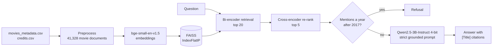
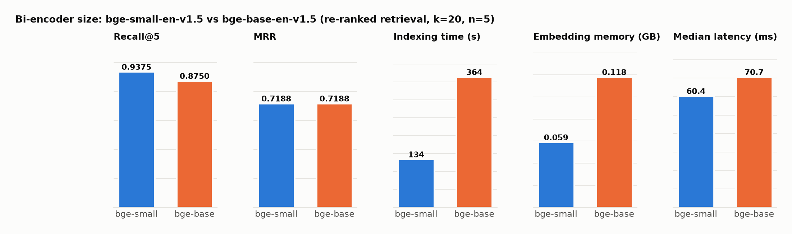
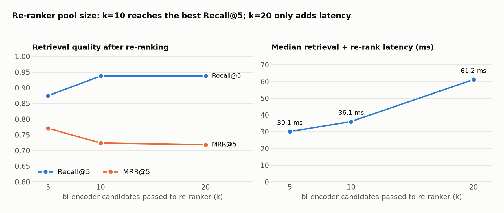
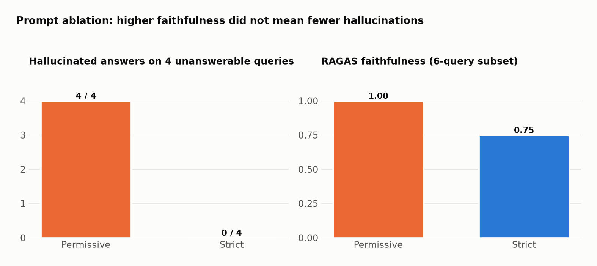
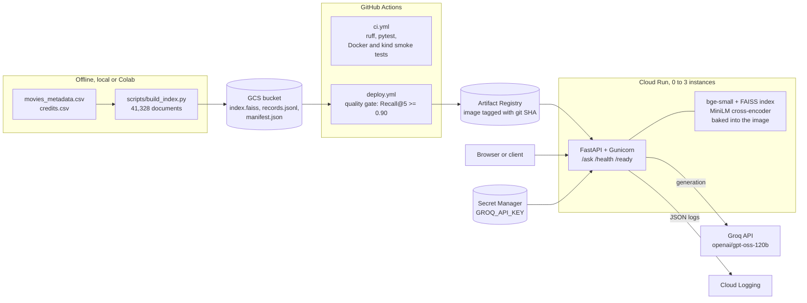

# Local Movie RAG

[](https://colab.research.google.com/github/efe-akpinar/local-movie-rag/blob/main/movie_qa_rag.ipynb)

Fully local question answering over 41k movies: bi-encoder retrieval with FAISS, cross-encoder re-ranking, and a 4-bit Qwen2.5-3B generator that cites its sources and refuses when the corpus can't answer.

## Highlights

- End-to-end RAG with no hosted APIs: `bge-small` embeddings and FAISS, a MiniLM cross-encoder re-ranker, Qwen2.5-3B-Instruct (4-bit NF4) generation and a local RAGAS judge
- Cross-encoder re-ranking raises Recall@5 from 0.875 to 0.9375 and fixes sequel confusion: *Toy Story* (1995) moves from rank 3 to rank 1 for "Who directed Toy Story?"
- A strict grounding prompt reduces hallucinated answers on unanswerable questions from 4/4 to 0/4, with a deterministic post-2017 year guard as a backstop
- Three controlled ablations (bi-encoder size, re-rank pool size, prompt) and a failure diary with before/after fixes
- The smaller embedding model wins on this corpus: `bge-small` beats `bge-base` on Recall@5 (0.9375 vs 0.875) with less than half the indexing time

## Overview

The system answers questions such as "Who directed Inception?" or "Which movie is about a shark terrorizing Amity Island?" from a fixed movie corpus. Every answer must be grounded in retrieved documents and cite movie titles in brackets. Questions the corpus can't support, such as films released after July 2017, get an exact refusal string. The notebook builds the corpus, indexes it, implements retrieval, re-ranking and generation, and evaluates the pipeline on a 20-query test set of standard, adversarial, sequel-confusion and unanswerable questions.



## Dataset

[The Movies Dataset](https://www.kaggle.com/datasets/rounakbanik/the-movies-dataset) by Rounak Banik on Kaggle, with movie metadata and credits collected from the TMDB API. Two files are used: `movies_metadata.csv` (45,466 rows) and `credits.csv`.

Preprocessing steps:

- drop rows with a missing title or an empty overview
- apply a 31 July 2017 release cutoff
- deduplicate by title, keeping the longer overview
- merge in the director and top-5 cast from `credits.csv`

The result is 41,328 movie documents, each with Title, Year, Genres, Director, Cast and Overview fields. Overviews are short: mean 56.4 whitespace tokens, median 50, max 187.

The data is not included in this repository. See the Kaggle page for its license terms.

## Approach

| Stage | Choice |
|---|---|
| Embeddings | `BAAI/bge-small-en-v1.5` (384-d), L2-normalized |
| Vector store | FAISS `IndexFlatIP` (exact cosine search), persisted to disk with a `records.jsonl` sidecar for metadata |
| Retrieval | top 20 bi-encoder candidates |
| Re-ranking | `cross-encoder/ms-marco-MiniLM-L-6-v2`, top 5 contexts |
| Generation | `Qwen/Qwen2.5-3B-Instruct`, 4-bit NF4 (bitsandbytes), greedy decoding, 180 new tokens |
| Grounding | strict system prompt (context only, exact refusal string, `[Title]` citations) plus a regex year guard for post-2017 questions |
| Evaluation | Recall@5/10 and MRR on 16 answerable queries; hallucination count on 4 unanswerable queries; RAGAS faithfulness, context precision and answer relevancy with a local Qwen2.5-3B judge |

`run_query(query)` is the single entry point and always returns `{"answer": str, "retrieved_titles": list[str]}`, even on empty input or internal errors.

## Results

Retrieval quality on the 16 answerable test queries:

| Configuration | Recall@5 | Recall@10 | MRR |
|---|---|---|---|
| Bi-encoder only | 0.8750 | 0.9375 | 0.7630 (top 10) |
| Bi-encoder + cross-encoder | 0.9375 | n/a | 0.7188 (top 5) |

Ablations:

| Ablation | Setting | Recall@5 | MRR | Other |
|---|---|---|---|---|
| Bi-encoder size | `bge-small-en-v1.5` | 0.9375 | 0.7188 | 134.37 s indexing, 0.059 GB, 60.40 ms median latency |
| | `bge-base-en-v1.5` | 0.8750 | 0.7188 | 363.94 s indexing, 0.118 GB, 70.69 ms median latency |
| Re-rank pool | k = 5 | 0.8750 | 0.7708 | 30.06 ms median latency |
| | k = 10 | 0.9375 | 0.7240 | 36.07 ms median latency |
| | k = 20 | 0.9375 | 0.7188 | 61.18 ms median latency |
| Prompt (year guard off) | Permissive | n/a | n/a | 4/4 hallucinated on unanswerable, RAGAS faithfulness 1.00 |
| | Strict | n/a | n/a | 0/4 hallucinated on unanswerable, RAGAS faithfulness 0.75 |

RAGAS on the strict prompt (6-query subset): faithfulness 0.750, context precision 0.625, answer relevancy 0.663.


*`bge-small` matches or beats `bge-base` on retrieval quality with less than half the indexing time and half the memory.*


*Growing the re-rank pool from 5 to 10 candidates adds recall; going to 20 only adds latency.*


*The permissive prompt scores higher on RAGAS faithfulness yet fails to refuse any of the unanswerable questions.*

## Key findings

- **Re-ranking fixes sequel confusion.** The bi-encoder ranked *Toy Story 3* above the 1995 original with scores clustered around 0.7. The cross-encoder moved the original to rank 1 with much clearer separation.
- **Faithfulness is not correctness.** The permissive prompt scored 1.00 on RAGAS faithfulness while answering all four unanswerable questions instead of refusing. For *Oppenheimer* (2023), it named the director of a loosely matching documentary in the corpus.
- **Document format matters as much as the model.** Adding director and cast fields to each document turned "Who directed Inception?" from a refusal into a correct, cited answer, with identical retrieval.
- **Bigger isn't automatically better.** On short, proper-noun-heavy overviews, `bge-small` beat `bge-base`. k=10 is the best recall/latency trade-off for the re-ranker.

Limitations: RAGAS ran on a 6-query subset with a 3B local judge that often produced unparseable output, so those scores are indicative. Deduplicating by title alone drops same-title films; for example, the 2012 *The Avengers* is lost to the 1998 film.

## Tech stack

Python, PyTorch, sentence-transformers, FAISS, Hugging Face Transformers with bitsandbytes 4-bit quantization, pandas, RAGAS 0.2.9 with LangChain Hugging Face wrappers. The notebook was run on Google Colab with a T4 GPU.

## Project structure

```
local-movie-rag/
├── movie_qa_rag.ipynb   # pipeline, ablations, evaluation and discussion, with outputs
├── figures/             # charts used in this README
├── requirements.txt
└── README.md
```

At runtime the notebook also writes `rag_indexes/` (FAISS indexes), `movies_preprocessed.pkl` and a few CSV result files. These are gitignored.

## How to run

The intended configuration (Qwen2.5-3B in 4-bit) needs a CUDA GPU. The free Colab T4 runtime is enough and produced the results above. Only `movies_metadata.csv` and `credits.csv` from the [Kaggle dataset](https://www.kaggle.com/datasets/rounakbanik/the-movies-dataset) are needed.

**On Colab (recommended)**

1. Click **Open in Colab** above and switch to a GPU runtime (Runtime → Change runtime type → T4 GPU).
2. Upload `movies_metadata.csv` and `credits.csv` through the Files panel. They land in `/content`, where the notebook looks for them.
3. Run all cells. The first code cell installs the packages Colab doesn't ship with (FAISS, bitsandbytes, RAGAS). The first run encodes the corpus and saves FAISS indexes to `rag_indexes/`.

**Locally**

1. Download the data into `data/` (or next to the notebook), manually or with the Kaggle CLI:
   ```bash
   kaggle datasets download -d rounakbanik/the-movies-dataset -p data --unzip
   ```
2. Install dependencies and open the notebook:
   ```bash
   pip install -r requirements.txt
   jupyter notebook movie_qa_rag.ipynb
   ```
3. Run all cells. Later runs load the FAISS indexes from `rag_indexes/` instead of re-encoding.

A local NVIDIA GPU with CUDA matches the Colab setup. On a CPU-only machine, including Macs, the code falls back to `Qwen2.5-0.5B-Instruct` for generation and the RAGAS judge. That is fine for a smoke test, but encoding 41k documents on CPU is slow and the answers and scores will not match the ones reported here.

## Production deployment

The notebook remains the record of the original experiments. The same pipeline also runs as a web service: the `movie_rag/` package, a FastAPI app served by Gunicorn in Docker, CI/CD to Google Cloud Run behind a retrieval-quality gate, Prometheus and Grafana monitoring, Locust load tests and optional Kubernetes manifests.

**Hosted generation uses Groq.** The deployed service generates answers with Groq (`openai/gpt-oss-120b`, temperature 0, set by the `GROQ_MODEL` repository variable) instead of the local 4-bit Qwen2.5-3B used in the notebook. Only the model's final answer is used; its reasoning is discarded. Everything around the LLM call is the notebook's code: preprocessing, `bge-small` + FAISS retrieval of the top 20, cross-encoder re-ranking to the top 5, the strict grounded prompt, the exact refusal string, `[Title]` citations and the post-2017 year guard. `LLM_PROVIDER=local` runs Qwen2.5-3B on a GPU, and `LLM_PROVIDER=fake` is a deterministic stand-in for tests.

### Architecture



### Run it locally

The index artifacts go in `artifacts/index/`. Build them from the Kaggle CSVs, or download the deployed ones from GCS ([docs/gcp-setup.md](docs/gcp-setup.md), step 9, which also uploads a local build with `--upload-only`).

```bash
pip install torch --index-url https://download.pytorch.org/whl/cpu   # CPU wheel; skip on a GPU machine
pip install -e ".[dev]"
python scripts/build_index.py data/ --out-dir artifacts/index        # full corpus, must be 41,328 documents
cp .env.example .env    # LLM_PROVIDER=fake needs no key; use groq + GROQ_API_KEY for real answers
docker compose up --build
```

| URL | What |
|---|---|
| http://localhost:8080 | Question page; the API docs are at `/docs` |
| http://localhost:9090 | Prometheus |
| http://localhost:3000 | Grafana, with the provisioned "Movie RAG" dashboard |

For a quick try without the dataset, `python scripts/build_index.py tests/fixtures/movies --expected-count 12` builds a 12-movie fixture index. Without Docker, run `gunicorn -c gunicorn.conf.py movie_rag.api:app` with `INDEX_DIR` and `LLM_PROVIDER` set. On macOS, also set `OMP_NUM_THREADS=1` and `KMP_DUPLICATE_LIB_OK=TRUE` for anything that loads the models: faiss and PyTorch each bundle their own OpenMP runtime, and two copies in one process crash. The Docker image runs Linux and is not affected.

The notebook's interface is kept as a function:

```python
from movie_rag.pipeline import run_query

run_query("Who directed Toy Story?")  # {"answer": "...", "retrieved_titles": [...]}; never raises
```

| Endpoint | Behavior |
|---|---|
| `POST /ask` | `{"question": "..."}`, 1 to 300 characters. Returns the answer, citations, the top 5 titles with re-rank scores and per-stage timings in ms. 422 for invalid input, 429 above 20 requests per minute per client IP, 503 if the LLM is unavailable |
| `GET /health` | Liveness |
| `GET /ready` | 200 once the models and the index are loaded |
| `GET /metrics` | Prometheus metrics when `METRICS_PUBLIC=true` (set in docker compose); otherwise 404, as on Cloud Run |
| `GET /` | Question page with example questions |

All settings are environment variables ([movie_rag/config.py](movie_rag/config.py)); [.env.example](.env.example) lists the common ones. `WEB_CONCURRENCY` sets the number of Gunicorn workers, each with its own copy of the models. The rate limit is counted per worker. On Cloud Run (`TRUST_X_FORWARDED_FOR=true`) the client IP is the last `X-Forwarded-For` entry, the one Google's front end appends; elsewhere it is the socket address.

### CI/CD

[`ci.yml`](.github/workflows/ci.yml) runs on every push and pull request:

1. `ruff check`, `ruff format --check` and `pytest`. The tests run offline with the fake generator, a hashing encoder and a 12-movie fixture corpus.
2. Builds the Docker image with the fixture index and starts it with `LLM_PROVIDER=fake`. Waits for `/ready`, then checks `/health`, an answer from `/ask` and the refusal of a post-2017 question.
3. Creates a kind cluster with metrics-server, loads the image, applies the manifests in `k8s/`, waits for the rollout and runs the same smoke test through a port-forward.

[`deploy.yml`](.github/workflows/deploy.yml) runs on pushes to `main` and on manual dispatch:

1. Authenticates to Google Cloud with Workload Identity Federation (no JSON key) and downloads the index from GCS.
2. **Quality gate:** runs `scripts/eval_retrieval.py --min-recall 0.90` on the notebook's 16 answerable test queries. If re-ranked Recall@5 is below 0.90, nothing is built or deployed.
3. Builds the image and pushes it to Artifact Registry, tagged with the git SHA.
4. Deploys to Cloud Run: 2 GiB, 1 vCPU, concurrency 4, 0 to 3 instances, public, `GROQ_API_KEY` from Secret Manager, a dedicated runtime service account.
5. Smoke-tests `/health` and `/ask` on the new URL and fails the run if either fails.

The one-time Google Cloud and GitHub setup is in [docs/gcp-setup.md](docs/gcp-setup.md). Until its repository variables exist, the deploy job is skipped.

### Monitoring

| Metric | Meaning |
|---|---|
| `movie_rag_requests_total{endpoint, status}` | Request count by endpoint and HTTP status |
| `movie_rag_request_latency_seconds{endpoint}` | Request latency histogram |
| `movie_rag_stage_latency_seconds{stage}` | Retrieve, re-rank and generate stage histograms |
| `movie_rag_refusals_total` | Answers that were refusals |
| `movie_rag_errors_total{type}` | Errors: `generation_unavailable`, `rate_limited`, `pipeline`, `unhandled` |

The Grafana dashboard ([monitoring/grafana/dashboards/movie-rag.json](monitoring/grafana/dashboards/movie-rag.json)) shows request rate, p50 and p95 latency, stage timings, refusal rate, error rate and errors by type. Every `/ask` also writes one JSON log line with the request id, latency, refusal flag and stage timings; the question text and the API key are never logged. On Cloud Run these lines are parsed by Cloud Logging. Prometheus and Grafana are part of the local stack only: on Cloud Run `METRICS_PUBLIC` is false, so `/metrics` returns 404.

### Load testing

[loadtest/README.md](loadtest/README.md) covers headless Locust runs against the local stack and against Cloud Run (for example 20 users, spawn rate 2, 5 minutes), and `scripts/summarize_loadtest.py` turns Locust's CSV into the table below. Raise `RATE_LIMIT_PER_MINUTE` for the duration of a test, because a single load generator counts as one client IP.

### Service results

Values are filled in from the scripts named in the last column; `TODO` means not measured yet.

| Measurement | Value | Source |
|---|---|---|
| Documents in the index | 41,328 | `scripts/build_index.py` |
| Re-ranked Recall@5 / MRR, 16 answerable queries (deployed index) | TODO | `scripts/eval_retrieval.py` (deploy quality gate) |
| Refusals on the 4 unanswerable queries (Groq) | TODO | `scripts/eval_generation.py` |
| Expected title cited on the 16 answerable queries (Groq) | TODO | `scripts/eval_generation.py` |
| Docker image size | TODO | `docker image ls` in CI |
| Cold start until `/ready` (model and index load) | TODO | `pipeline loaded` log line, `load_ms` |
| `/ask` p50 / p95 / p99 latency, 20 users, 5 min (Cloud Run) | TODO | Locust + `scripts/summarize_loadtest.py` |
| Requests per second and failure rate (same run) | TODO | Locust + `scripts/summarize_loadtest.py` |

### Kubernetes (optional)

`k8s/` holds a Deployment (startup and readiness probes on `/ready`, liveness on `/health`, CPU and memory requests and limits), a Service, a ConfigMap, a Secret template without values and a CPU-based HorizontalPodAutoscaler (1 to 3 replicas). CI tests them on kind with the fake provider. For a real cluster, point the image at Artifact Registry, create the Secret with `kubectl create secret generic movie-rag-secrets --from-literal=GROQ_API_KEY=...` and set `LLM_PROVIDER` to `groq` in the ConfigMap.

### Service layout

```
movie_rag/            # config, preprocess, index, retrieve, generate, pipeline, metrics, api, static page
scripts/              # build_index, eval_retrieval, eval_generation, smoke_test, summarize_loadtest
tests/                # offline unit tests and the 12-movie fixture corpus
loadtest/             # Locust user and instructions
monitoring/           # Prometheus config, Grafana datasource and dashboard
k8s/                  # optional Kubernetes manifests
docs/gcp-setup.md     # one-time Google Cloud setup
Dockerfile, docker-compose.yml, gunicorn.conf.py, .github/workflows/
```
